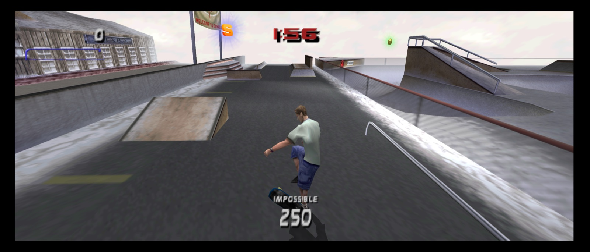
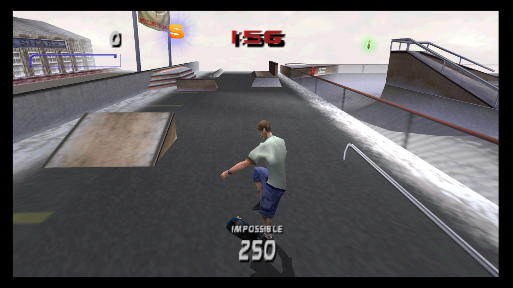

# THPS3 64: Recompiled

A native PC port of *Tony Hawk's Pro Skater 3* for the Nintendo 64, for macOS and Windows, as an **early preview**. Built with
[N64Recomp](https://github.com/N64Recomp/N64Recomp), [N64ModernRuntime](https://github.com/N64Recomp/N64ModernRuntime)
and [RT64](https://github.com/rt64/rt64).

### [Download the latest preview](https://github.com/THPS64Recomp/THPS3-64Recomp/releases) (v0.1.0-preview)

See also: [THPS1 64: Recompiled](https://github.com/THPS64Recomp/THPS1-64Recomp) (v0.1) and
[THPS2 64: Recompiled](https://github.com/THPS64Recomp/THPS2-64Recomp) (early preview).

**This repository doesn't contain the game. You need your own dump of the N64 cartridge.** The app builds the game from
it on the first start.

## Early preview

THPS3 64: Recompiled uses the same host as THPS1 64: Recompiled and passes its own automated test suite, but it has had much
less hand play. Expect bugs we haven't seen, and back up your `saves/` folder before you rely on a career. Your reports
decide what gets fixed before its v0.1: [docs/TESTING.md](docs/TESTING.md) says what to try, and **Unlock All Levels** in
the Cheats tab gets you to every level quickly.

## Supported dumps

| Release | SHA-1 (`.z64`) |
|---|---|
| USA | `7b9438120c67214afaea09f4b106c54ef8f366c5` |

`.z64`, `.n64` and `.v64` all work; the file name doesn't matter.
## Features

- **Widescreen:** 16:9, 21:9 or fit to window. The HUD moves to the screen edges.
- **High frame rate:** the game's 30 fps interpolated to your display's refresh rate (60 Hz, 120 Hz, or higher).
- **Modern rendering:** RT64 on Metal (macOS) or Direct3D 12 (Windows), any resolution, MSAA.
- **Recomp settings:** press **Esc** (or **Back** on a controller) for graphics, controls, sound and cheats. The game's
  own options are still in its menus.
- **Modern controls:** any SDL controller, hot-plugging, two players. Xbox-style layout (ollie, flip, grab and grind on the
  face buttons instead of the N64's C buttons) or the original N64 layout.
- **Saves:** Controller Pak saves in a standard `.mpk` file: careers, created skaters and parks.
- **Cheats:** Unlock All Levels, Perfect Balance, Slow Motion, Skip to Restart, Always Special. Off by default.

## System requirements

- **macOS:** 13 or later, Apple Silicon or Intel. The first start needs Apple's Command Line Tools (the app offers to
  install them).
- **Windows:** 10 or 11, x64, a Direct3D 12 GPU. Everything needed is in the zip.
- **Linux:** no download yet. The code builds on Linux in CI, but nobody has run the game on a Linux desktop. If you
  build it from source ([BUILDING.md](BUILDING.md)), tell us how it went in [Discussions](https://github.com/THPS64Recomp/THPS3-64Recomp/discussions).

## Install

**macOS**
1. Download `THPS3-64Recomp-v0.1.0-preview-macOS-universal.zip` and unzip it.
2. Move **THPS3 64 Recompiled.app** to Applications.
3. Open it. macOS blocks the first open because the app isn't notarized:
   - macOS 15+: System Settings > Privacy & Security > **Open Anyway**.
   - macOS 13-14: right-click the app > **Open** > **Open**.

**Windows**
1. Download `THPS3-64Recomp-v0.1.0-preview-Windows-x64.zip` and extract it to a folder you can write to (not Program Files).
2. Run `THPS3-64Recomp`. If SmartScreen appears: **More info** > **Run anyway**.

**First start:** choose your ROM dump (or drop it on the window). The app checks it and builds the game, which takes a
few seconds. Later starts skip this.

**Saves and settings** live in `~/Library/Application Support/THPS3-64Recomp/` (macOS) or
`%LOCALAPPDATA%\THPS3-64Recomp\` (Windows). Put an empty `portable.txt` next to the app to keep them beside it.

**Updating:** replace the app. Saves and settings carry over.

## Controls

| Action | Controller (Xbox names) | Keyboard |
|---|---|---|
| Ollie | A (bottom) | Space |
| Flip / grab | X (left) / B (right) | J / L |
| Grind | Y (top) | I |
| Spin, revert | LB / RB (shoulder buttons) | Q / E |
| Manual | up, then down | arrow keys |
| Pause | Start (Menu) | Return |
| Recomp settings | Back (View) | Esc |

All bindings and the N64 layout: [docs/MANUAL.md](docs/MANUAL.md).

## Known issues

- An early preview: this list is incomplete.
- A short freeze when a level loads.
- At 21:9, a far wall can drop out at the right edge.
- Two players (split screen) stays a 4:3 picture in widescreen.
- Two rare crashes were each seen once in about 60 launches during development. Please send `crash.log` if you see one.
Full list: [docs/KNOWN-ISSUES.md](docs/KNOWN-ISSUES.md).

## Bugs and feedback

- **Bugs:** use the [bug report form](https://github.com/THPS64Recomp/THPS3-64Recomp/issues/new/choose). Attach `crash.log` if the app crashed.
- **Questions and play-testing notes:** [Discussions](https://github.com/THPS64Recomp/THPS3-64Recomp/discussions).
- **What to try:** [docs/TESTING.md](docs/TESTING.md).
- Never attach your ROM or files built from it.

## Building from source

See [BUILDING.md](BUILDING.md). You need your own dump to build a playable game, too. To send a change, see
[CONTRIBUTING.md](CONTRIBUTING.md).

## AI use

AI was used as a tool to assist development of the code, the docs and the testing, with human direction,
play-testing and debugging throughout. AI-assisted contributions are welcome if they follow [CONTRIBUTING.md](CONTRIBUTING.md). Please
report problems here, not to N64Recomp, N64ModernRuntime or RT64. How each release is tested:
[docs/VERIFICATION.md](docs/VERIFICATION.md).

## Thanks and credits

This project builds on open-source tools and libraries made by other people, and we learned a lot from them. None of
their authors took part in this project or endorse it.

- **Recompilation and rendering:** [N64Recomp](https://github.com/N64Recomp/N64Recomp) and
  [N64ModernRuntime](https://github.com/N64Recomp/N64ModernRuntime) (Wiseguy and contributors),
  [RT64](https://github.com/rt64/rt64) (Darío and contributors).
- **RT64 setup and settings menu:** parts adapted from [Zelda64Recomp](https://github.com/Zelda64Recomp/Zelda64Recomp).
- **Decompilation tools:** [splat](https://github.com/ethteck/splat),
  [spimdisasm](https://github.com/Decompollaborate/spimdisasm) and [rabbitizer](https://github.com/Decompollaborate/rabbitizer)
  (split and disassemble the game's code), [n64sym](https://github.com/shygoo/n64sym) (finds the N64 library functions),
  [rnc_propack_source](https://github.com/lab313ru/rnc_propack_source) (the game's compression format).
- **Libraries in the app:** [SDL](https://www.libsdl.org) (window, input, audio), [RmlUi](https://github.com/mikke89/RmlUi),
  [FreeType](https://freetype.org) and [lunasvg](https://github.com/sammycage/lunasvg) (the settings menu).

What came from where, and every licence: [NOTICE.md](NOTICE.md) and [docs/THIRD_PARTY.md](docs/THIRD_PARTY.md). The
code shared by all three games lives in [THPS64Host](https://github.com/THPS64Recomp/THPS64Host).

## License and legal

- **License:** GPL-3.0-only ([LICENSE](LICENSE)). It gives no rights in the game.
- **No game content:** this repository and its releases hold no ROMs, game code or assets. Don't share your dump or the
  files built from it.
- **Unofficial:** not affiliated with Activision, Neversoft, Edge of Reality, Tony Hawk, Nintendo, or the N64Recomp,
  N64ModernRuntime and RT64 projects. *Tony Hawk's Pro Skater* is a trademark of Activision. Nintendo 64 is a trademark
  of Nintendo.
- **Rights holders:** to request a change or removal, write to center.collie.41@icloud.com, or use [GitHub's DMCA process](https://docs.github.com/en/site-policy/content-removal-policies/dmca-takedown-policy).
